# TerminalPrompt

Pure-Nim synchronous text, password, confirmation, single-select, and
multi-select prompts.

## Platform support

`terminal_prompt` has been tested on Linux and Windows. On Windows I tested with the Terminal app which comes with Windows, other terminals may or may not work. It should also work on macOS through its standard POSIX terminal and ANSI/VT support, but macOS has not yet been tested directly.

## Requirements

- Nim 2.0.0 or newer
- [terminal_style](https://github.com/titanomachy/terminal-style) 0.1.1 or newer
- [terminal_screen](https://github.com/titanomachy/terminal-screen) 0.1.1 or newer
- No runtime dependencies beyond `terminal_style` and `terminal_screen`

## Contents

- [Platform support](#platform-support)
- [Requirements](#requirements)
- [Installation](#installation)
- [Quick start](#quick-start)
- [API overview](#api-overview)
- [Examples](#examples)
- [Documentation](#documentation)
- [Compatibility and security](#compatibility-and-security)
- [Development](#development)
- [License](#license)

## Installation

Nimble installs both dependencies automatically:

```sh
nimble install https://github.com/titanomachy/terminal-prompt
```

For a source checkout, install dependencies before running the checks:

```sh
nimble install --depsOnly
nimble releaseCheck
```

During suite development, sibling checkouts can instead be linked with
`nimble develop`.

## Quick start

Import the facade, ask a question, and handle the result:

```nim
import terminal_prompt

let name = askText("Project name", default = "my-project")
case name.status
of promptAnswered:
  echo "Creating ", name.value
of promptCancelled:
  echo "cancelled"
of promptEndOfInput:
  echo "input closed"
```

Save as `hello.nim` and run `nim r hello.nim`. Enter accepts the default;
Escape or Ctrl+C cancels. Every prompt returns `PromptResult[T]` with separate
answered, cancelled, and EOF outcomes. Read `.value` after checking the status,
or use `.valueOr(fallback)` for a shared cancellation/EOF fallback.

## API overview

Each prompt waits for one answer and returns a `PromptResult` containing the
answer or a cancellation/EOF status. Convenience calls cover common settings;
the `init…PromptOptions` constructors expose typed choices, initial selections,
and custom runtime settings. The examples check `isAnswered` before reading
the value; use the Quick start's `case` pattern to handle all three outcomes.

| Prompt | Main API | Highlights |
| --- | --- | --- |
| [Text](#text) | `askText`, `TextPromptOptions` | Defaults, placeholders, editing, validation |
| [Password](#password) | `askPassword`, `PasswordPromptOptions` | Masked or no-feedback entry, redacted results |
| [Confirmation](#confirmation) | `askConfirm`, `ConfirmPromptOptions` | Yes/no labels and an empty-input default |
| [Single select](#single-select) | `askSelect`, `SelectPromptOptions[T]` | Typed values, hints, disabled choices |
| [Multi-select](#multi-select) | `askMultiSelect`, `MultiSelectPromptOptions[T]` | Initial selections, toggles, choice-order results |
| [Customization](#customization) | `PromptTheme`, `PromptKeyBindings`, `PromptRuntimeOptions` | Semantic colors, help text, streams, bindings |

Each animation records the linked runnable example. Expand **Still image** for
a snapshot; the nearby `.cast` link provides the source recording.

Redirected input uses plain lines and one-based choice numbers; multi-select
accepts comma- or space-separated numbers.

### Text

`askText` collects a string with interactive editing, including cursor movement,
Backspace, and Delete. A `placeholder` shows a hint when the editor is empty;
it is never submitted as the answer. Use `default` when Enter on an empty
editor should return a predefined value.

Here, `requireName` rejects an empty answer and lets the user try again.
Validators return `""` to accept or a message to display. The animation first
submits an empty answer, then enters `nim-app` and prints the accepted name.

```nim
import terminal_prompt

proc requireName(value: string): string =
  if value.len == 0: "Enter a project name." else: ""

let response = askText("Project name", placeholder = "my-project",
  validator = requireName)
if response.isAnswered:
  echo "Creating ", response.value
```

[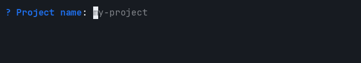](examples/text_prompt.nim)

<details>
<summary>Still image</summary>

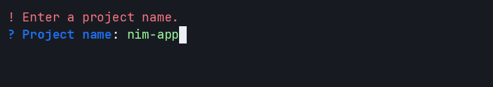

</details>

[Example](examples/text_prompt.nim) · [Source recording](docs/recordings/text_prompt.cast)

```sh
nim r --path:src examples/text_prompt.nim
```

### Password

`askPassword` collects a secret without rendering its contents. In an
interactive terminal, `mask = "•"` displays one bullet per entered grapheme;
use `mask = ""` to hide even the length. Password entry supports the same
editing controls as text entry.

The example prints only a receipt message after submission. Password results
redact their debug output, but `.value` still returns an ordinary Nim string
that must never be logged. See the [security guidance](docs/security.md) for
the full contract.

```nim
import terminal_prompt

let response = askPassword("Publishing token", mask = "•")
if response.isAnswered:
  echo "Token received."
```

[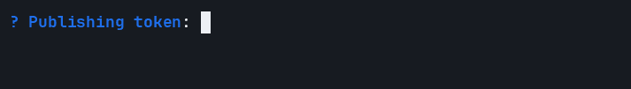](examples/password_prompt.nim)

<details>
<summary>Still image</summary>

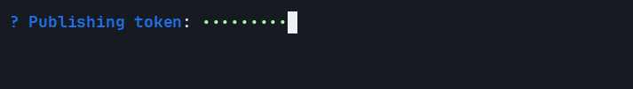

</details>

[Example](examples/password_prompt.nim) · [Source recording](docs/recordings/password_prompt.cast)

```sh
nim r --path:src examples/password_prompt.nim
```

### Confirmation

`askConfirm` returns a boolean for a yes/no decision. Pressing Enter with no
text accepts the configured default, so `default = false` makes an empty
answer skip project creation. Type `y`/`n` or `Yes`/`No` to choose explicitly;
matching is case-insensitive.

Use `yesLabel` and `noLabel` to customize the displayed choices. Their initials
also work when distinct; otherwise, enter the full label. Invalid input shows
a message and retries. The animation enters `yes`, producing an answered
result whose value is `true`.

```nim
import terminal_prompt

let response = askConfirm("Create project?", default = false)
if response.isAnswered:
  echo (if response.value: "Creating project." else: "Skipped.")
```

[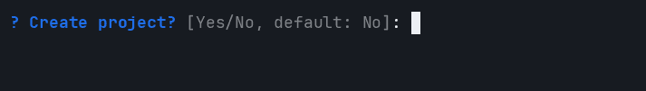](examples/confirm_prompt.nim)

<details>
<summary>Still image</summary>

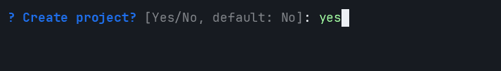

</details>

[Example](examples/confirm_prompt.nim) · [Source recording](docs/recordings/confirm_prompt.cast)

```sh
nim r --path:src examples/confirm_prompt.nim
```

### Single select

`askSelect` returns one choice. Up/Down moves focus, Home/End jumps to the
first/last enabled choice, and Enter submits. Disabled entries remain visible
but are skipped during navigation. Navigation wraps by default; set
`wrapNavigation = false` to stop at the ends.

Each `choice` pairs a display label with a typed value. Here, selecting `HTTPS`
returns the integer `443`, and its hint explains the recommendation.
`initialIndex = some(1)` starts on that second entry because option indices
are zero-based. `Legacy` is displayed but cannot be selected.

```nim
import std/options
import terminal_prompt

let response = askSelect(initSelectPromptOptions("Port", @[
  choice("HTTP", 80),
  choice("HTTPS", 443, hint = "recommended"),
  choice("Legacy", 8080, disabled = true)
], initialIndex = some(1)))
if response.isAnswered:
  echo "Port: ", response.value
```

[](examples/single_select.nim)

<details>
<summary>Still image</summary>

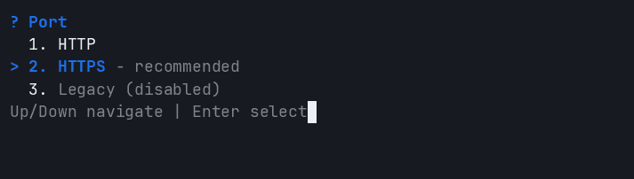

</details>

[Example](examples/single_select.nim) · [Source recording](docs/recordings/single_select.cast)

```sh
nim r --path:src examples/single_select.nim
```

### Multi-select

`askMultiSelect` returns a sequence of choices. Move with Up/Down, press Space
to toggle the focused entry, use `a` to select all enabled choices, or `c` to
clear. Changes stay in the prompt until Enter explicitly submits; submitting
an empty selection is also valid.

`initiallySelected = @[0]` checks Documentation before any input. The animation
adds Tests and briefly toggles Examples, then returns `@["docs", "tests"]`.
Returned values always follow the original choice order, regardless of the
order in which they were toggled.

```nim
import std/strutils
import terminal_prompt

let response = askMultiSelect(initMultiSelectPromptOptions("Features", @[
  choice("Documentation", "docs"),
  choice("Tests", "tests"),
  choice("Examples", "examples")
], initiallySelected = @[0]))
if response.isAnswered:
  echo "Enabled: ", response.value.join(", ")
```

[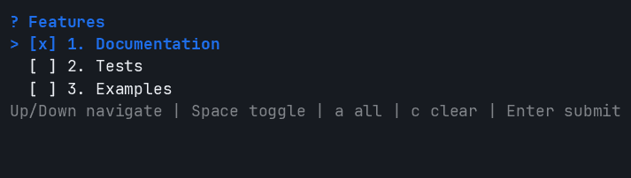](examples/multi_select.nim)

<details>
<summary>Still image</summary>

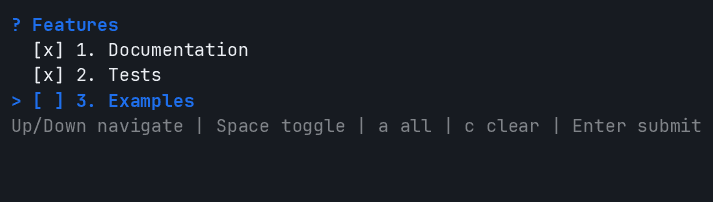

</details>

[Example](examples/multi_select.nim) · [Source recording](docs/recordings/multi_select.cast)

```sh
nim r --path:src examples/multi_select.nim
```

### Customization

`PromptTheme` assigns TerminalStyle colors and attributes to roles such as
question, answer, hint, and error. Start with `defaultPromptTheme()` and adjust
the roles you need. This example gives the question a bold blue color and
the answer a bright green color, with help text beside the question.

Runtime options control streams and bindings. Adding Ctrl+S to the default
submit bindings keeps Enter available too. The prompt writes to stderr while
the greeting uses stdout; supplied streams are borrowed and remain open after
the prompt finishes.

```nim
import terminal_prompt
import terminal_style

var theme = defaultPromptTheme()
theme.question = initTerminalStyle(
  foreground = rgbColor(120, 200, 255), attributes = {taBold})
theme.answer = initTerminalStyle(foreground = colorBrightGreen)

var bindings = defaultPromptKeyBindings()
bindings.submit.add keyBinding(keyText, "s", {modifierCtrl})

let response = askText(initTextPromptOptions("Display name",
  presentation = defaultPresentation("Ctrl+S also submits", theme),
  runtime = defaultRuntimeOptions(output = stderr, keyBindings = bindings)))
if response.isAnswered:
  echo "Hello, ", response.value
```

[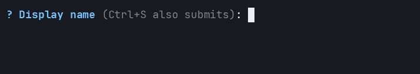](examples/prompt_customization.nim)

<details>
<summary>Still image</summary>

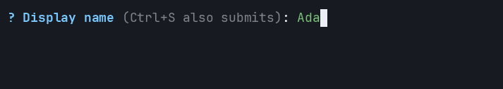

</details>

[Example](examples/prompt_customization.nim) · [Source recording](docs/recordings/prompt_customization.cast)

```sh
nim r --path:src examples/prompt_customization.nim
```

## Examples

Run the complete five-prompt setup flow:

```sh
nim r --path:src examples/project_setup.nim
```

Additional examples cover [custom themes](examples/custom_theme.nim),
[custom runtime and result handling](examples/custom_runtime.nim), and
[redirected automation](examples/redirected_workflow.nim). Compile-check every
example with `nimble examples`.

## Documentation

- [Public API reference](docs/api.md)
- [Prompt behavior](docs/prompts.md)
- [Runtime, fallback, and cleanup](docs/runtime.md)
- [Compatibility and performance](docs/compatibility.md)
- [Migration notes](docs/migration.md)
- [Security guidance](docs/security.md)

## Compatibility and security

CI exercises Nim 2.0.x and stable Nim on Linux, macOS, and Windows using the
compiler's default memory manager, plus ARC and ORC on stable Nim/Linux. A
prompt uses interactive mode only when both streams are terminals and raw input
plus ANSI output are available. Otherwise it falls back to plain line-oriented
I/O, so pipes, files, limited consoles, and `TERM=dumb` remain usable. On
Windows, interactive mode uses native console events plus VT output; older or
limited consoles fall back to line mode.

Password entry does not echo its answer, and password results redact their
debug representation. The returned `.value` is still an ordinary Nim string;
applications must not log it and cannot assume secure erasure. Read the full
[security guidance](docs/security.md) before collecting credentials.

## Development

The supported floor is Nim 2.0.0. The full local check is:

```sh
nimble releaseCheck
```

Individual tasks are `nimble compilePackage`, `nimble test`, `nimble testArc`,
`nimble testOrc`, `nimble testMemoryManagers`, `nimble examples`, `nimble docs`,
and `nimble benchmark`. Compiler products and generated docs are kept under
`build/`; the test suite also checks the output location, source-tree
cleanliness, dependency constraints, and package exclusions. The benchmark
measures viewport-backed selection with up to 100,000 choices; filtering
remains deferred until real usage demonstrates that its additional interaction
contract is justified.

Regenerate all README images, GIFs, and source recordings on a POSIX system:

```sh
python3 scripts/regenerate_media.py
```

This requires Asciinema 3, Agg 1.9 or newer, ImageMagick, and the
`JetBrainsMono Nerd Font Mono` font. See the [recording notes](docs/recordings/README.md)
for geometry, rendering settings, and how to rebuild one demo.

## License

TerminalPrompt is released under the [MIT License](LICENSE).
